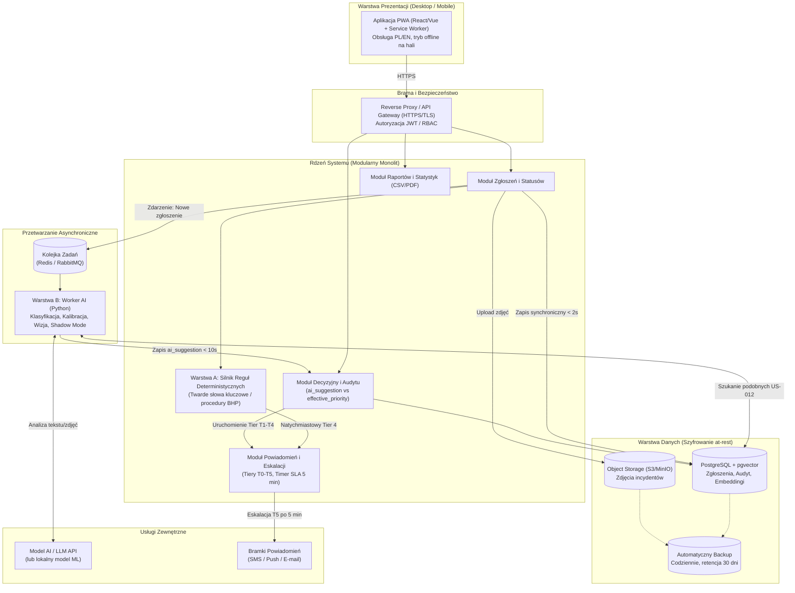

## 1. Kontekst projektowy i ograniczenia architektoniczne

Projekt architektury systemu **SafeWork** został dopasowany do realnych parametrów organizacji, zasobów zespołu oraz wymagań niefunkcjonalnych zdefiniowanych w dokumentacji:

| Parametr | Wartość / Ograniczenie | Implikacja architektoniczna |
| --- | --- | --- |
| **Skala i użytkownicy** | ~350 pracowników; maks. 100 użytkowników jednocześnie (RNF-WY-003). | Brak potrzeby budowy rozproszonej architektury mikroserwisowej; wystarczy pionowo skalowalny serwer aplikacji. |
| **Zespół realizacyjny** | 5 osób. | Konieczność minimalizacji narzutu DevOps i złożoności wdrożeniowej (jeden główny kod źródłowy, wspólny stack). |
| **Czas realizacji** | 19 tygodni w 4 fazach (MVP w 6 tygodni, integracja AI w Fazie 3 – 6 tygodni). | Architektura musi umożliwiać szybkie dostarczenie MVP bez AI, a następnie bezinwazyjne podpięcie modułu AI (w tym w trybie *Shadow Mode*). |
| **Wydajność** | Standardowe operacje < 2 s (RNF-WY-001); analiza AI < 10 s (RNF-WY-002). | Rozdzielenie synchronicznego zapisu zgłoszenia od asynchronicznego przetwarzania AI (kolejka zadań). |
| **Dostępność i backup** | 99,5% w godz. 6:00–22:00 (RNF-DW-001); codzienny backup z retencją 30 dni (RNF-DW-002). | Okno serwisowe w nocy (22:00–6:00) ułatwia aktualizacje i kopie zapasowe bez wymogu kosztownej architektury Active-Active. |
| **Środowisko pracy** | Hala produkcyjna (możliwy słaby zasięg); desktop + mobile (RNF-UZ-001); PL + EN (RNF-UZ-003). | Aplikacja webowa typu **PWA** (Progressive Web App) z obsługą buforowania offline. |
| **Bezpieczeństwo i audyt** | Role (RBAC), szyfrowanie w tranzycie i spoczynku, pełny ślad audytowy (RNF-BE-001 do 004). | Izolacja widoczności danych na poziomie zapytań, niemutowalny log zmian (`ai_suggestion` vs `effective_priority`). |

---

## 2. Wybrany styl architektoniczny: Modularny Monolit + Asynchroniczny Worker AI

Dla 5-osobowego zespołu, 6-tygodniowego terminu na MVP i obciążenia do 100 równoczesnych użytkowników optymalnym wyborem jest **Modularny Monolit** wsparty **asynchronicznym workerem AI** komunikującym się przez kolejkę zadań:

* **Dlaczego nie mikroserwisy?** Mikroserwisy przy tej skali wprowadziłyby zbędny narzut na sieciowość, zarządzanie rozproszonymi transakcjami i utrzymanie infrastruktury, co zagroziłoby terminowi 6 tygodni na MVP.

* **Dlaczego osobny Worker AI?** Zapis zgłoszenia przez pracownika musi zamknąć się w czasie < 2 sekund (RNF-WY-001), podczas gdy analiza tekstu, zdjęcia i szukanie podobnych incydentów przez AI może trwać do 10 sekund (RNF-WY-002). Wydzielenie przetwarzania AI do asynchronicznego workera (np. w Pythonie) izoluje awarie zewnętrznego API/modelu ML od głównego systemu i pozwala na łatwe uruchomienie trybu *Shadow Mode* (AI analizuje zdarzenia w tle, nie wpływając na UI).

---

## 3. Diagram architektury systemu (Mermaid)

---

## 4. Opis kluczowych komponentów i przepływu danych

### Warstwa Prezentacji (PWA)

* **Responsywny interfejs (RNF-UZ-001):** Jedna baza kodu obsługująca przeglądarki na komputerach kierowników oraz smartfony/tablety na hali produkcyjnej.

* **Odporność na brak zasięgu:** Zastosowanie Service Workerów i lokalnej bazy (IndexedDB) pozwala pracownikowi wypełnić formularz i zrobić zdjęcie w martwej strefie zasięgu na hali, a następnie zsynchronizować zgłoszenie po odzyskaniu połączenia.

### Rdzeń Systemu (Modularny Monolit)

* **Moduł Zgłoszeń i Statusów:** Obsługuje cykl życia zgłoszenia (`Nowe → W trakcie → Rozwiązane → Zamknięte`), walidację pól wymaganych (typ, miejsce, opis) oraz przypisywanie zadań przez kierownika.

* **Warstwa A – Silnik Reguł Deterministycznych:** Działa synchronicznie w momencie zapisu zgłoszenia. Wykrywa twarde reguły prawne i BHP (np. uraz, krew, pożar, wyciek chemikaliów) i bezwzględnie nadpisuje ocenę AI, natychmiast kierując zdarzenie do ścieżki krytycznej (Tier 4).

* **Moduł Decyzyjny i Audytu:** Realizuje zasadę rozdzielenia sugestii od decyzji – zapisuje wyniki AI wyłącznie w polach `ai_suggestion` / `ai_confidence_calibrated`, natomiast pole `effective_priority` aktualizowane jest po fuzji reguł i decyzji człowieka (Warstwa C). Wymusza podanie uzasadnienia (`override_reason`) przy obniżaniu priorytetu nadanego przez AI i zapisuje pełny ślad audytowy (RNF-BE-003).

* **Moduł Powiadomień i Eskalacji:** Implementuje stopniowaną reakcję (Tiery T0–T5). Dla zgłoszeń Tier 4 uruchamia licznik SLA (5 minut) – brak potwierdzenia odbioru przez kierownika automatycznie uruchamia eskalację do Dyrekcji (Tier 5).

### Przetwarzanie Asynchroniczne i AI (Warstwa B)

* **Kolejka Zadań (Redis/RabbitMQ) + Worker AI:** Po zapisaniu zgłoszenia w bazie danych, system publikuje zdarzenie w kolejce. Worker AI pobiera zgłoszenie i w czasie < 10 sekund:

1. Przeprowadza analizę semantyczną opisu, kontekstu lokalizacji (mapa zagrożeń zakładu) oraz zdjęcia.

2. Wylicza skalibrowany *Confidence Score* oraz wykrywa przypadki nierozpoznane (*out-of-distribution*).

3. Generuje wektor (embedding) zgłoszenia i odpytuje bazę `pgvector` w celu znalezienia podobnych incydentów z przeszłości (US-012).

4. Zapisuje wynik i uzasadnienie (`ai_rationale`, `ai_signals`) w bazie.

### Warstwa Danych

* **PostgreSQL + rozszerzenie `pgvector`:** Jedna baza danych obsługująca zarówno relacyjne dane operacyjne i logi audytowe, jak i wyszukiwanie wektorowe podobnych zgłoszeń. Eliminuje to konieczność utrzymywania osobnej bazy wektorowej przez 5-osobowy zespół.

* **Object Storage (S3 / MinIO):** Przechowywanie zdjęć z formularzy poza bazą relacyjną, z szyfrowaniem w spoczynku (RNF-BE-002).

---

## 5. Spełnienie wymagań niefunkcjonalnych i bezpieczeństwa

* **Kontrola dostępu i widoczność (RNF-BE-001, RNF-BE-004):** Implementacja RBAC (Pracownik, Kierownik, BHP/Dyrekcja, Administrator) z filtrowaniem na poziomie zapytań bazodanowych (Row-Level Security). Pracownik widzi wyłącznie własne zgłoszenia (oraz opcjonalnie zanonimizowane znaczniki na mapie zakładu), Kierownik widzi swój dział, a BHP/Dyrekcja całą organizację.

* **Szyfrowanie (RNF-BE-002):** Wymuszony protokół TLS 1.3 dla całego ruchu (w tranzycie) oraz szyfrowanie dysków bazy danych i Object Storage (AES-256 w spoczynku).

* **Dostępność i kopie zapasowe (RNF-DW-001, RNF-DW-002):** Wdrożenie w kontenerach (Docker) z automatycznym restartem usług i monitoringiem zdrowia (*health checks*). Codzienny, zautomatyzowany backup bazy i plików w nocnym oknie serwisowym (poza godzinami 6:00–22:00) z 30-dniową retencją.

---

## 6. Dopasowanie architektury do harmonogramu wdrożenia (19 tygodni)

Architektura pozwala na przyrostowe budowanie systemu bez przepisywania fundamentów:

1. **Faza 1 – MVP (6 tygodni):** Wdrożenie aplikacji PWA, modułu zgłoszeń, bazy PostgreSQL, Object Storage oraz podstawowych powiadomień. Brak kolejki i Workera AI – minimalna złożoność na start.

2. **Faza 2 – Panel Kierownika i Statystyki (4 tygodnie):** Rozbudowa monolitu o widoki działowe, przypisywanie pracowników, śledzenie czasów obsługi i pierwsze metryki.

3. **Faza 3 – Integracja AI (6 tygodni):** Dołożenie kolejki zadań, rozszerzenia `pgvector`, Silnika Reguł Deterministycznych (Warstwa A) oraz Workera AI (Warstwa B). Uruchomienie w trybie **Shadow Mode** (zbieranie etykiet bez wpływu na użytkowników), a następnie przejście do trybu doradczego i stopniowanej reakcji (T0–T5).

4. **Faza 4 – Raporty i Eksporty (3 tygodnie):** Dodanie modułu generowania raportów CSV/PDF oraz panelu monitoringu dryfu i kalibracji modelu AI.

Jakby sie ktos pytal czym jest ten monolit:

**Modularny monolit** to styl architektoniczny, w którym cała aplikacja jest budowana i uruchamiana jako **jeden program** (monolit), ale jej kod jest wewnątrz ściśle podzielony na **niezależne, odizolowane moduły biznesowe**.

Łączy prostotę wdrożenia tradycyjnego monolitu z porządkiem i separacją odpowiedzialności znaną z mikroserwisów.

### Główne cechy modularnego monolitu

* **Jedna jednostka wdrożeniowa:** Cały system kompiluje się i wdraża razem (np. jako jeden kontener Docker). Nie trzeba zarządzać siecią kilkunastu osobnych serwerów.
* **Ścisłe granice między modułami:** W przeciwieństwie do klasycznego monolitu (który często zamienia się w tzw. *spaghetti code*), moduły nie mogą dowolnie korzystać ze swojego wewnętrznego kodu. Komunikują się wyłącznie przez jasno zdefiniowane interfejsy publiczne lub wewnętrzne zdarzenia.
* **Izolacja danych:** Nawet jeśli wszystkie moduły korzystają z jednej bazy danych (np. PostgreSQL), każdy moduł jest właścicielem swoich tabel. Moduł *Raportów* nie modyfikuje bezpośrednio tabel modułu *Zgłoszeń* – pobiera dane wyłącznie przez jego interfejs.
* **Komunikacja w pamięci (in-memory):** Moduły wymieniają dane przez zwykłe wywołania funkcji w pamięci RAM, a nie przez sieć (HTTP). Jest to znacznie szybsze, prostsze w debugowaniu i odporne na problemy sieciowe.

### Porównanie z innymi podejściami

| Cecha | Tradycyjny Monolit | Modularny Monolit | Mikroserwisy |
| --- | --- | --- | --- |
| **Wdrożenie (DevOps)** | Bardzo proste (1 aplikacja) | Bardzo proste (1 aplikacja) | Złożone (wiele usług, orkiestracja) |
| **Porządek i izolacja kodu** | Niska (łatwo o splątanie zależności) | Wysoka (wymuszone granice modułów) | Bardzo wysoka (fizyczna separacja) |
| **Komunikacja wewnętrzna** | W pamięci (szybka) | W pamięci (szybka) | Sieciowa (opóźnienia, awarie sieci) |
| **Łatwość rozwoju w małym zespole** | Wysoka na starcie, potem spada | Wysoka przez cały cykl życia | Niska (duży narzut na infrastrukturę) |

W projekcie **SafeWork** (5-osobowy zespół, 6 tygodni na MVP, obciążenie do 100 użytkowników jednocześnie) modularny monolit daje optymalny kompromis: pozwala szybko dowieźć działający system bez tracenia czasu na skomplikowaną infrastrukturę, a jednocześnie utrzymuje porządek w kodzie. Jeśli w przyszłości któryś moduł (np. raportowanie) będzie wymagał niezależnego skalowania, jego wydzielenie do osobnego mikroserwisu będzie proste, ponieważ granice zostały już wyznaczone.

adekwatność architektury do skali projektu: Architektura nie wydaje sie wybiegac ponad skale projektu
ryzyko overengineeringu: niskie
czy AI stosuje modne technologie bez uzasadnienia: nie, uzasadnia je
jasność odpowiedzialności komponentów: w miare
utrzymywalność i testowalność rozwiązania: ten modularny monolit
czy rozwiązanie jest technicznie możliwe, ale niepraktyczne: wydaje sie praktyczne

### PROMPT

Wpływ szyfrowania na szybkość obsługi paczek o rozmiarze 1–10 MB jest **pomijalny — to ułamek procenta całkowitego czasu operacji (zwykle 1–10 milisekund)**.

Współczesne procesory (zarówno serwerowe, jak i w smartfonach) posiadają sprzętowe wsparcie dla kryptografii (instrukcje AES-NI oraz ARMv8 Crypto). Dzięki temu pojedynczy rdzeń szyfruje dane z prędkością **1–5 GB/s**.

### Porównanie wąskich gardeł dla pojedynczego zgłoszenia

Prawdziwym ograniczeniem w systemie SafeWork nie jest szyfrowanie, lecz **przepustowość sieci na hali produkcyjnej**.

| Etap przetwarzania | Paczka 1 MB (po kompresji w PWA) | Paczka 10 MB (surowe zdjęcia) | Wpływ na odczucia użytkownika |
| --- | --- | --- | --- |
| **Szyfrowanie w tranzycie (TLS 1.3)** | < 1 ms | ~2–5 ms | Niezauważalny |
| **Szyfrowanie w spoczynku (AES-256 na S3/dysku)** | < 1 ms | ~2–10 ms | Niezauważalny |
| **Kompresja zdjęcia w przeglądarce (PWA)** | ~100–300 ms | 0 ms (pominięta) | Minimalny |
| **Wysłanie po słabym Wi-Fi/LTE (np. 4 Mb/s upload)** | **~2 s** | **~20 s** | **Krytyczny** |

### Jak to działa w zaprojektowanej architekturze

* **Szyfrowanie w tranzycie (TLS 1.3):** Realizowane w locie (strumieniowo) przez przeglądarkę i Reverse Proxy. Najbardziej kosztowny element — nawiązanie połączenia (*TLS handshake*) — odbywa się raz i jest utrzymywany dla kolejnych żądań, zajmując ok. 20–50 ms.
* **Szyfrowanie w spoczynku (at-rest):** Odbywa się na poziomie systemu plików (np. szyfrowane wolumeny dyskowe) lub silnika Object Storage (SSE-S3 w MinIO/AWS). Aplikacja w ogóle nie marnuje na to zasobów CPU, a dyski NVMe/SSD z warstwą szyfrującą nie wykazują zauważalnego spadku prędkości zapisu przy skali ~100 użytkowników.
* **Narzut na rozmiar danych:** Szyfrowanie symetryczne (AES-GCM) nie zwiększa istotnie rozmiaru pliku — dodaje zaledwie kilkadziesiąt bajtów metadanych (wektor inicjalizujący i tag uwierzytelniający).

Aby dotrzymać wymagania **RNF-WY-001 (< 2 s na zapis zgłoszenia)**, kluczowa jest więc nie rezygnacja z szyfrowania ani jego optymalizacja, lecz **kompresja zdjęć po stronie klienta (PWA)** oraz asynchroniczne przesyłanie dużych załączników w tle, podczas gdy sam tekst zgłoszenia trafia do bazy natychmiast.
